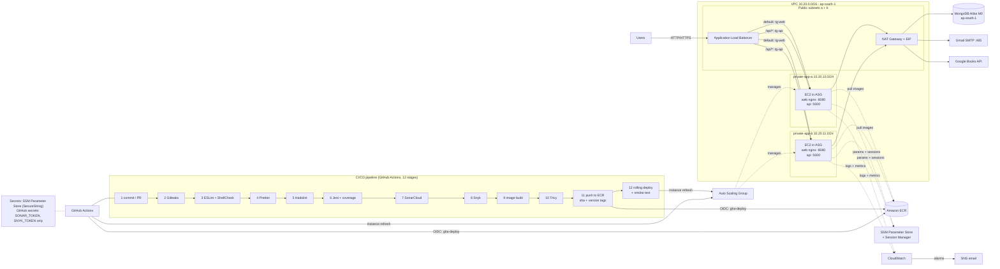

# Nocturne Library – AWS Architecture Plan

Scope: production environment for the DevOps final project. Infra is created via console/CLI and every value below must be mirrored in the README so it can be rebuilt. Numbers marked "≈" are estimates.

## 1. Region

**ap-south-1 (Mumbai).** Nearest AWS region to Pakistan (lowest latency for demo/grading), 3 AZs, among the cheaper regions, and MongoDB Atlas offers the free **M0** tier there. The Atlas cluster **must be created on AWS / ap-south-1** so DB traffic stays in-region. Use AZs `ap-south-1a` and `ap-south-1b`.

## 2. Network / address plan

VPC `nocturne-vpc` = **10.20.0.0/16**, DNS hostnames + DNS resolution enabled.

| Subnet           | AZ          | CIDR                         | Usable IPs* | Route table                                  | Contents                  |
| ---------------- | ----------- | ---------------------------- | ----------- | -------------------------------------------- | ------------------------- |
| public-a         | ap-south-1a | 10.20.0.0/24                 | 251         | `rt-public`: 0.0.0.0/0 → IGW                 | ALB node, NAT GW          |
| public-b         | ap-south-1b | 10.20.1.0/24                 | 251         | `rt-public`                                  | ALB node (NAT GW-b if HA) |
| private-app-a    | ap-south-1a | 10.20.10.0/24                | 251         | `rt-private-a`: 0.0.0.0/0 → NAT-a            | EC2 (ASG)                 |
| private-app-b    | ap-south-1b | 10.20.11.0/24                | 251         | `rt-private-b`: 0.0.0.0/0 → NAT-a (or NAT-b) | EC2 (ASG)                 |
| private-data-a/b | a / b       | 10.20.20.0/24, 10.20.21.0/24 | 251         | _reserved, not created_                      | future in-VPC data tier   |

\*AWS reserves 5 addresses per subnet. Public subnets do **not** auto-assign public IPs; only the ALB and NAT live there. All routes also include the implicit `local` route for 10.20.0.0/16.

**NAT trade-off**

| Option                                         | ≈ cost          | If AZ-a fails                                                                                     |
| ---------------------------------------------- | --------------- | ------------------------------------------------------------------------------------------------- |
| 1 NAT GW in public-a, both private RTs → it    | ≈ $41/mo + data | AZ-b instances still serve the SPA but lose egress (Atlas, SMTP, Books, ECR pulls) → API degrades |
| 1 NAT GW per AZ, each private RT → same-AZ NAT | ≈ $82/mo + data | AZs fully independent (true HA)                                                                   |

**Recommendation:** one NAT GW day-to-day. The required HA demo (terminate an _instance_) works with one NAT because the AZ stays up; state in the README that a whole-AZ outage is not covered. Optionally add NAT-b for the grading window only. Atlas IP access list = the NAT Elastic IP(s) only (add the second EIP if NAT-b exists).

**VPC endpoints (optional; reduce NAT data, keep AWS traffic private)**

| Endpoint                            | Type      | ≈ cost                       | Saves                             |
| ----------------------------------- | --------- | ---------------------------- | --------------------------------- |
| `s3`                                | Gateway   | **free**                     | ECR image layers (served from S3) |
| `ecr.api`, `ecr.dkr`                | Interface | ≈ $8/mo each per AZ + per-GB | image pulls                       |
| `ssm`, `ssmmessages`, `ec2messages` | Interface | ≈ $8/mo each per AZ          | Session Manager / Run Command     |
| `logs`                              | Interface | ≈ $8/mo per AZ               | CloudWatch Logs                   |

Add the **S3 gateway endpoint** (free). Interface endpoints are billed hourly per AZ (6 endpoints × 2 AZs ≈ $95/mo), which is more than the NAT data they would save at this traffic level, so skip them unless the team wants to demonstrate them. NAT is still required for Atlas, Gmail and Google Books.

## 3. Load balancer

Internet-facing ALB `nocturne-alb` in public-a/b, SG `sg-alb`.

| Listener              | Action                                                                                                                                           |
| --------------------- | ------------------------------------------------------------------------------------------------------------------------------------------------ |
| HTTP :80              | With ACM cert + domain: redirect 301 → HTTPS :443. Without: forward using the rules below (record "HTTP only, no domain" in README/SECURITY.md). |
| HTTPS :443 (optional) | ACM certificate, a TLS 1.2+/1.3 security policy (e.g. `ELBSecurityPolicy-TLS13-1-2-2021-06`), same rules                                         |

| Priority | Condition       | Target group | Port      | Health check                                 |
| -------- | --------------- | ------------ | --------- | -------------------------------------------- |
| 10       | path `/api/*`   | `tg-api`     | 5000 HTTP | `GET /health` (liveness, no DB), success 200 |
| default  | everything else | `tg-web`     | 8080 HTTP | `GET /health`, success 200                   |

Target groups: type `instance`, interval 10 s, timeout 5 s, healthy threshold 2, unhealthy threshold 2 (≈20 s to flip either way). **Deregistration delay 30 s** (default 300 s makes rolling deploys slow; API calls are short). **No stickiness**: auth is a stateless JWT, so any instance can serve any request. The ASG is attached to both TGs, uses **ELB health checks**, grace period 120 s.

Health checks are split on purpose. The backend's `/health` is liveness only (200 whenever the process is up, never touches the DB), so the ALB and ASG only replace instances whose process is actually dead. `/api/health` is readiness (503 when Atlas is unreachable); it is used by the post-deploy smoke test and a CloudWatch synthetic/alarm, never by the target group. That way an Atlas outage raises an alarm instead of making the ASG churn healthy instances.

## 4. Security groups

| SG                                        | Inbound                                                         | Outbound                                                                                                                                                                                           |
| ----------------------------------------- | --------------------------------------------------------------- | -------------------------------------------------------------------------------------------------------------------------------------------------------------------------------------------------- |
| `sg-alb`                                  | TCP 80, 443 from 0.0.0.0/0                                      | TCP 8080, 5000 → `sg-app`                                                                                                                                                                          |
| `sg-app` (EC2)                            | TCP 8080 from `sg-alb`; TCP 5000 from `sg-alb`. **No port 22.** | TCP 443 → 0.0.0.0/0 (ECR, SSM, CloudWatch, Google Books); TCP 27017 → 0.0.0.0/0 (Atlas; Atlas itself allows only the NAT EIP); TCP 465 → 0.0.0.0/0 (Gmail SMTPS); DNS via VPC resolver is implicit |
| `sg-vpce` (only with interface endpoints) | TCP 443 from `sg-app`                                           | –                                                                                                                                                                                                  |

Containers on the same instance talk over the Docker Compose network, not through the SG. **NACLs** stay at the default allow-all: SGs are stateful and already enforce "ALB-only" at the instance; stateless NACL rules (ephemeral return ports) add breakage risk without meaningful extra protection here.

## 5. IAM roles (least privilege)

IAM OIDC provider `token.actions.githubusercontent.com`, audience `sts.amazonaws.com`. **No long-lived access keys in GitHub.**

| Role                                              | Trusted principal / condition                                                                                                                                                | Permissions summary                                                                                                                                                                                                                                                                                                                                                                                                                                                                                                                                                  |
| ------------------------------------------------- | ---------------------------------------------------------------------------------------------------------------------------------------------------------------------------- | -------------------------------------------------------------------------------------------------------------------------------------------------------------------------------------------------------------------------------------------------------------------------------------------------------------------------------------------------------------------------------------------------------------------------------------------------------------------------------------------------------------------------------------------------------------------- |
| `gha-ci`                                          | OIDC; `sub` `StringLike` `repo:Vania-s-Organization@357513584/Nocturne-Library@1179123000:*` (PRs, any branch)                                                               | Nothing required: CI builds and scans images on the runner. If kept: `ecr:GetAuthorizationToken` + read-only (`BatchGetImage`, `GetDownloadUrlForLayer`, `DescribeImages`) on the two repos. **No push.**                                                                                                                                                                                                                                                                                                                                                            |
| `gha-deploy`                                      | OIDC; `sub` `StringEquals` `repo:Vania-s-Organization@357513584/Nocturne-Library@1179123000:environment:production` (below; the `production` environment only allows `main`) | `ecr:GetAuthorizationToken` (`*`); push (`InitiateLayerUpload`, `UploadLayerPart`, `CompleteLayerUpload`, `PutImage`, `BatchCheckLayerAvailability`, `BatchGetImage`, `DescribeImages`) on `nocturne-frontend` + `nocturne-backend` only; `ssm:GetParameter`/`PutParameter` on `/nocturne/prod/image_tag*`; `autoscaling:StartInstanceRefresh` on the ASG ARN; `autoscaling:Describe*`, `elasticloadbalancing:DescribeTargetHealth`; optional `ssm:SendCommand` limited to `AWS-RunShellScript` and instances tagged `Project=nocturne` (`ssm:resourceTag/Project`). |
| `nocturne-ec2` (instance profile)                 | Service `ec2.amazonaws.com`                                                                                                                                                  | `AmazonSSMManagedInstanceCore`; `CloudWatchAgentServerPolicy`; ECR pull (`GetAuthorizationToken` + `BatchGetImage`, `GetDownloadUrlForLayer`, `BatchCheckLayerAvailability` on the two repos); `ssm:GetParameter*` on `arn:aws:ssm:ap-south-1:<ACCOUNT_ID>:parameter/nocturne/prod/*`; `kms:Decrypt` only if a customer-managed key is used (default `aws/ssm` needs none).                                                                                                                                                                                          |
| `nocturne-admin` / `nocturne-operator` (optional) | Team members via IAM Identity Center or MFA-enforced IAM users                                                                                                               | Admin only for building infra; day-to-day read-only + Session Manager.                                                                                                                                                                                                                                                                                                                                                                                                                                                                                               |

`gha-deploy` trust policy:

```json
{
  "Version": "2012-10-17",
  "Statement": [
    {
      "Effect": "Allow",
      "Principal": {
        "Federated": "arn:aws:iam::<ACCOUNT_ID>:oidc-provider/token.actions.githubusercontent.com"
      },
      "Action": "sts:AssumeRoleWithWebIdentity",
      "Condition": {
        "StringEquals": {
          "token.actions.githubusercontent.com:aud": "sts.amazonaws.com",
          "token.actions.githubusercontent.com:sub": "repo:Vania-s-Organization@357513584/Nocturne-Library@1179123000:environment:production"
        }
      }
    }
  ]
}
```

The CD deploy job declares `environment: production`, so the token's `sub` is `repo:Vania-s-Organization@357513584/Nocturne-Library@1179123000:environment:production` (not `...:ref:refs/heads/main`). The `@<id>` parts are GitHub's immutable subject format, used by default for repositories created after 15 Jul 2026; a name-only subject is rejected. The `production` environment in GitHub restricts deployment branches to `main`, which keeps the "main only" guarantee. Rendered from `infra/policies/gha-deploy-trust.json` by `infra/20-iam.sh`.

## 6. Secrets

| Value                                                                                          | Where                                                                          | Notes                                                                                            |
| ---------------------------------------------------------------------------------------------- | ------------------------------------------------------------------------------ | ------------------------------------------------------------------------------------------------ |
| `MONGO_URI`, `JWT_SECRET`, `SMTP_USER`, `SMTP_PASS` (Gmail app password), Google Books API key | SSM Parameter Store **SecureString** `/nocturne/prod/<NAME>`                   | Standard parameters are free; Secrets Manager (≈ $0.40/secret/month) only pays off with rotation |
| `image_tag`, `previous_image_tag`                                                              | SSM **String** `/nocturne/prod/image_tag`, `/nocturne/prod/previous_image_tag` | Deploy + rollback state                                                                          |
| AWS account ID / role ARNs, SonarCloud & Snyk tokens                                           | GitHub Actions secrets/variables                                               | No AWS keys                                                                                      |

At boot, launch-template user data runs `aws ssm get-parameters-by-path --path /nocturne/prod/ --with-decryption`, writes `/opt/nocturne/.env` (root, mode 600), logs in to ECR, and runs `docker compose -f docker-compose.prod.yml up -d` with `IMAGE_TAG` from `/nocturne/prod/image_tag`. Secrets never go into the AMI, launch template, images, or repo.

## 7. Deploy and rollback flow

1. PR merged to `main`; stages 1–10 already green.
2. Stage 11 (`gha-deploy` via OIDC): build `web` + `api`, Trivy scan, push to ECR (**tag immutability ON**) as `sha-<short SHA>` and `vX.Y.Z`.
3. Copy `/nocturne/prod/image_tag` → `previous_image_tag`; set `image_tag` = new `sha-…`.
4. `aws autoscaling start-instance-refresh` with `MinHealthyPercentage=50` (or `100` + `MaxHealthyPercentage=200` to launch before terminating), `InstanceWarmup=120`. New instances boot on the new tag; old ones drain (30 s).
5. Stage 12: `scripts/smoke-test.sh` against the ALB DNS (`/health`, `/api/health`, one read endpoint) with retries.
6. Failure → set `image_tag` back to `previous_image_tag`, start another instance refresh, fail the job (SNS alarm fires). Manual `rollback.yml` (`workflow_dispatch`, input = image tag) does the same for any tag in ECR.

Alternative: SSM Run Command `docker compose pull && up -d` on one instance at a time — faster, but in-place rather than immutable.

## 8. Diagram



## 9. Cost estimate (ap-south-1, ≈ USD/month, running 24×7)

| Item                                                        | ≈ /month               |
| ----------------------------------------------------------- | ---------------------- |
| 2 × t3.micro (x86, 2 vCPU / 1 GiB) + 2 × 8 GiB gp3          | ≈ $17 (t3.small ≈ $33) |
| ALB (hours + low LCU)                                       | ≈ $20                  |
| NAT gateway ×1 (+ ≈ $0.056/GB processed)                    | ≈ $41 (×2 ≈ $82)       |
| Public IPv4 addresses (ALB nodes, NAT EIP) at $0.005/h each | ≈ $11                  |
| CloudWatch (few GB logs, 1 dashboard, ~5 alarms)            | ≈ $3–6                 |
| ECR storage (< 2 GB with lifecycle policy)                  | < $1                   |
| SSM standard params, S3 gateway endpoint, SNS email         | ≈ $0                   |
| **Total (1 NAT, t3.micro)**                                 | **≈ $90–100**          |

All figures approximate — verify with the AWS Pricing Calculator; free tier/credits may reduce the EC2 line. **t4g** (Graviton/ARM) is cheaper but needs multi-arch `docker buildx` images; recommend **t3.micro** (t3.small if both containers run out of memory) to keep CI simple.

Cost controls: AWS Budgets alerts (e.g. $30 and $60) → email; ECR lifecycle rule keeping the last ~20 images; log retention 14 days. Between work sessions, set ASG min/desired to 0 and delete the NAT gateway (keep the EIP so the Atlas list stays valid; an unattached EIP is still billed). **Do not tear down during grading** — the live link must stay up.

## 10. Open decisions for the team

- Domain + ACM cert (HTTPS) or HTTP-only ALB DNS name?
- One NAT vs one per AZ (or NAT-b only for the grading window)?
- t3.micro vs t3.small (measure memory with both containers running).
- Deploy mechanism: ASG instance refresh (recommended, immutable) vs SSM Run Command rolling.
- Decided: `tg-api` health-checks `/health` (liveness); `/api/health` (readiness) is for the smoke test and alarms.
- Decided: nginx also proxies `/api/` to the API container (same-origin locally); in AWS the ALB's `/api/*` rule sends API traffic straight to `tg-api`, so the browser is same-origin there too and CORS stays closed.
- Who owns the AWS account, Budgets alerts and IAM Identity Center setup?
